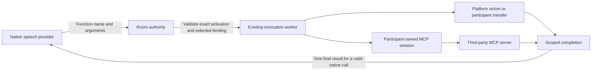

# Platform and MCP tools for native speech-to-speech

Research date: 2026-11-09. Code inspected at `f9eefd6a`.
Status: implementation started. Native startup now retains the private shared tool
registry separately from provider schemas and dispatches host, platform, variable
and transfer bindings through the shared invocation registry. Native allocations
now own the same MCP owner/session components as text activations. Both paths use
the shared blocking/non-blocking admission decision; full completion and
conformance acceptance remains incomplete.

Planning amendment, 2026-11-09: the user's follow-up requires common internal
implementation and behavior parity with LLM participants, including conversation
modes. The [shared participant tool milestone](../../labnotes/milestones/shared-participant-tool-execution.md)
now owns implementation tasks and progress. Provider-specific findings below are
protocol evidence; the user permits existing-adapter API plumbing needed by the
shared semantic contract. New per-model tool policy remains outside the milestone.

## Conclusion

Provider-native speech sessions can use Vxpipe platform tools and connected MCP
tools through their function-calling interfaces. Much of the machinery already
exists: provider codecs, supervised invocation workers, participant transfer,
tool descriptors, tenant catalog snapshots, and participant-owned MCP sessions.
The work is to connect these components to the native STS activation and complete
its result settlement.

The new milestone takes over [Package 1 of the existing STS completion plan](../../labnotes/milestones/agent-sts-completion-plan.md#package-1-sts-tool-bindings)
under the user's common-code/parity direction, retaining D4's single native result
constraint. This research does not complete that work or reopen the completed
[participant MCP ownership milestone](../../labnotes/milestones/participant-owned-mcp-sessions.md).

## What works and what is missing

| Capability | Current evidence | Remaining work |
| --- | --- | --- |
| Provider function definitions, incoming calls, outgoing results | Google, GPT-Live and ElevenLabs adapters contain the wire operations. | Exercise newly connected bindings through each supported adapter. |
| Participant `transfer` | Compiled-room Morse and GPT-Live fixture tests cover successful transfer and failure recovery. | Preserve that behavior while unifying dispatch. This evidence concerns Vxpipe participant transfer; it does not establish arbitrary PSTN transfer support. |
| Blocking host tool | ElevenLabs compiled-room fixture executes `ping` and receives its result. | Reuse the existing execution path. |
| Platform `get_current_time` and `hangup` | Native calls use shared validation and invocation workers. Hangup publishes its public result and rechecks source/policy before room authorization. | Include in the final cross-path conformance suite. |
| Call-variable tools | Compiled native rooms read/update permitted variables through retained private bindings; unselected update tools are rejected. | Include in the final cross-path conformance suite. |
| Connected MCP tools | Native allocations use the same IntegrationOwner, session supervisor and invocation handler as text activations. Controlled native calls exercise aliases, readiness, tenant isolation and teardown. Console integration cases prove saved disconnect/credential replacement, stale catalog pins and one in-flight outcome without retry. | Complete interrupted-completion and conformance acceptance under the shared milestone. |
| Non-blocking/background tools | LLM and ordinary/duplex native fixtures share blocking/non-blocking admission, retained pending work, and consumption-qualified release. Held caller input is discarded without replay. | Complete interrupted-delivery, replay and conformance acceptance; report unsupported semantic operations explicitly. |

Native startup is composed in
[SpeechToSpeechActivation](../../apps/vxpipe_call_engine/lib/vxpipe/call_engine/plan_startup/speech_to_speech_activation.ex):
it validates schema projections before allocation and compiles the executable
`ToolRegistry` against the exact new MCP owner during allocation. The registry
stays on the private runtime separately from the provider's schema projection.
[SpeechToSpeech.Tools](../../apps/vxpipe_call_engine/lib/vxpipe/call_engine/room_authority/speech_to_speech/tools.ex)
now resolves that registry before admission, matching participant and activation
against the recorder and current capability. It submits the resulting binding
to the same `InvocationRegistry` and handlers used by LLM participants. Silent
deferral is removed. Superseded direct completion/timeout handlers and unused
wrappers are removed; the owned invocation registry supplies production outcomes.
Started publication follows successful registry admission. Fresh invalid or
unselected requests receive a bounded rejection; fresh requests after input
permission is revoked fail explicitly. Active native duplicates preserve the
original association. Activation and private call reference determine the opaque
invocation ID, so a completed call replay cannot execute again while its ID is
retained by the existing bounded registry. Replay detection precedes argument
validation and terminates the invalid exchange without sending a second result.
References rejected before registry submission and IDs evicted from the bounded
retention window are outside that duplicate-protection guarantee.
Native results use the shared semantic session boundary and retain their completion
lease across reversible stop-holds. Final compiled-room conformance acceptance
still remains; dispatch alone is not full parity.

## Provider protocol findings

| Existing adapter | Provider contract | Implication |
| --- | --- | --- |
| OpenAI GPT-Live | Configure functions in `delegation.responses.tools`; collect calls from nested `response.output_item.done`; return `function_call_output` through `response.item.create`, then request continuation with `response.create`. | Keep the existing GPT-Live adapter. Its envelope differs from classic OpenAI Realtime. [Official delegation guide](https://developers.openai.com/api/docs/guides/live-delegation). |
| ElevenLabs Realtime | Session configuration accepts function names, descriptions and parameter schemas. The service uses OpenAI Realtime-compatible WebSocket events. Our adapter uses `conversation.item.create` for function output. | Reuse the existing standalone Realtime session; an ElevenLabs-hosted agent is not required. [Session schema](https://elevenlabs.io/docs/api-reference/conversations/create-client-secret), [compatibility guide](https://elevenlabs.io/docs/eleven-agents/guides/openai-realtime-compatibility). |
| Google Gemini Live | The application declares functions and returns matching `FunctionResponse` objects. The current documentation lists synchronous and asynchronous calls for Gemini 3.8 Live, the model in our adapter. | Basic function execution fits the existing adapter. Native background calls additionally need its `NON_BLOCKING` behavior and result scheduling wire support. [Official Live tools guide](https://aistudio.google.com/docs/live-api/tools). |

Provider support and Vxpipe implementation support are separate facts. Google's
current table lists asynchronous-only calling for 3.8 Live Extended Thinking,
synchronous-only for 3.1 Flash Live Preview, and both for 2.5 Flash Live Preview.
Our Google adapter does not currently encode asynchronous behavior/scheduling.
Do not infer late-result support from a provider name or enable another model
without its corresponding implementation and acceptance tests. [Google model/tool
matrix](https://aistudio.google.com/docs/live-api/tools).

## Recommended execution path



For example, the model requests `find_appointment`. Vxpipe resolves that name to
the selected tenant connection and pinned MCP tool, executes it through that
participant's MCP session, and sends the bounded result back through the native
provider protocol. A later `transfer` request enters the existing Vxpipe transfer
operation. MCP credentials and executable process handles remain private to
Vxpipe; the provider sees only selected schemas, arguments and results.

### 1. Connect the existing bindings

Retain the private descriptors produced by
[ToolDescriptors](../../apps/vxpipe_call_engine/lib/vxpipe/call_engine/agent_runtime/tool_descriptors.ex)
alongside the wire-safe schema projection. Resolve requests by the exact selected
name, including injected call-variable tools. Reuse
[InvocationBinding](../../apps/vxpipe_call_engine/lib/vxpipe/call_engine/tool/invocation_binding.ex)
and [InvocationExecution](../../apps/vxpipe_call_engine/lib/vxpipe/call_engine/tool/invocation_execution.ex),
which already execute host, platform, variable, transfer and remote MCP handlers.

Apply the existing [ToolRegistry argument validation](../../apps/vxpipe_agent_runtime/lib/vxpipe/agent_runtime/tool_registry.ex)
before submission and retain the room's current capability, source, activation
and policy checks. Unsupported
bindings must fail explicitly at admission, or return a bounded failure for an
unexpected runtime request. Remove silent `:deferred` behavior.

Handle `PlatformResult` as an internal effect plus public result.
`hangup` must use the existing room-authorized end-call path, and transfer must
preserve its commit/teardown ordering. Serializing either effect as ordinary
tool JSON is insufficient. Terminal hangup or successful transfer may retire the
source provider session; do not attempt a late reply through the retired source.

### 2. Give the native activation its MCP sessions

Reuse `IntegrationOwner` and its session `DynamicSupervisor` from the
[text activation graph](../../apps/vxpipe_call_engine/lib/vxpipe/call_engine/agent_activation/runtime_graph.ex)
inside the agent-owned
[STS allocation tree](../../apps/vxpipe_call_engine/lib/vxpipe/call_engine/capability/speech_to_speech/tree.ex).
Create them only when MCP tools are selected. Preserve the native tree's existing
temporary allocation/failure semantics while enforcing the same
[participant lifetime contract](participant-mcp-ownership.md).

Startup needs an ordering adjustment: schema projection may use already resolved
catalog metadata before allocation, while executable bindings require the exact
owned session reference. The implementation binds the exact owner PID after
lightweight tree construction and gates input on both provider and MCP readiness.
The shared initializer runs through a deferred continuation for native allocations
so its room-budget query cannot deadlock supervisor startup. Readiness probes run
outside capability callbacks; failed initialization or expired recovery terminates
through the existing room failure boundary. Partial startup rolls back with the
allocation. Text startup retains its existing synchronous recovery contract.

Reuse tenant snapshots, selected-tool pins, current credential/authorization
checks, readiness deadlines and retirement cleanup. Destination preparation
during transfer owns separate sessions; failure cleans up the destination while
the source remains usable. Call termination removes the owned resources. Ordinary
speech interruption must not terminate an already admitted business operation.
Catalog-refresh jobs remain independent maintenance; they are not part of the
audio path. No new cache tables, job system or cross-call session pool is needed.

### 3. Complete native result settlement and bounded execution

Implementation decision, 2026-11-09: route the typed
`{:tool_result, call_ref, result}` operation through the existing Session/Channel
command slot. For origin-aware allocations it uses `submit_input/3` with the
currently authorized response context, without fabricating caller input. Preserve
the original tool's stable source/allocation/policy authority separately from its
retired speech context. A stop-held completion retains its existing lease until
release; mute preserves its existing native acceptance semantics. Do not relabel
old audio or rerun the operation to deliver its result.

The user approved the necessary existing-adapter API plumbing while requiring all
tool behavior to stay common. Context-aware adapters must associate continuation
with the supplied context; no context-free fallback can establish that contract.
The earlier callbacks lacked this operation, so common probe acceptance alone is
insufficient. Adapter protocol fixtures and common room acceptance must pass before
closing C3. This amendment adds no vendor-specific executor or policy.

Ordinary and source-controlled releases both retry the existing completion lease;
permanent source/policy loss or rejected provider delivery terminates explicitly.
Google accepts a changed result context only for the exact pending call at an
explicit idle boundary with settled caller, model and playback state and no
resumption ambiguity. Its ordinary input and recovery quiescence remain unchanged.
An in-progress, omitted-status or unsettled exchange cannot establish fresh
output authority. Local protocol fixtures prove continuation attribution; these
checks do not claim live vendor interoperability.

D4 already selects one final native result per call. Do not introduce the text
agent's interim `running` response/private continuation protocol into STS.
Retired provider associations must never receive results meant for an earlier
source. The earlier research recommendation was to defer native background tools.
The user's follow-up instead requires both conversation modes in common engine
code, with provider sessions implementing semantic delivery rather than owning
tool policy. An unsupported operation must fail explicitly, but rejecting every
non-blocking binding cannot satisfy the new milestone's parity requirement.

The execution budget and completion lifecycle need separate acceptance:

- Both paths use the existing application-configured invocation budgets through
  `Tool.InvocationConfig`, including transfer preparation's operation deadline.
  A controlled MCP operation completes after 5.1 seconds without retry, and
  configured expiry and capacity/result limits pass. No environment flags or
  separate native execution settings were added.
- `ToolCompletions` now acknowledges through the existing registry after local
  provider acceptance or an authorized terminal effect, releasing completed-tool
  capacity. Rejected delivery terminates explicitly without replaying the business
  operation. Common speech interruption now preserves tool-only associations, and
  reversible transfer holds preserve same-source accepted work. Ordinary and
  duplex Morse transfer success/failure pass. Provider cancellation retains the
  accepted worker until its bounded outcome, then fails explicitly if its native
  result association was lost. Origin-aware stop-held results now use fresh
  continuation authority after release; permanent authorization loss terminates
  explicitly. Retained-ID replay and bounded eviction pass. Native tool usage now
  reuses InvocationUsage/ToolAttempt through the existing completion bridge,
  ordered before terminal results. Current bridge and activation checks prevent
  stale attribution. Shared race suites pass; final conformance remains open.

Native transport acceptance does not prove remote execution or durable receipt.
GPT-Live documents no separate success acknowledgement for `response.item.create`.
Use the adapter's local acceptance and existing error/lifecycle handling; preserve
an uncertain outcome on disconnect, and never rerun a side-effecting tool merely
to retry result delivery. [GPT-Live continuation contract](https://developers.openai.com/api/docs/guides/live-delegation).

## Scope and performance

This is an integration and lifecycle change across startup, native dispatch and
completion handling. Existing executors, MCP clients and provider adapters should
do the work. A second Jido/LLM decision loop, new agent framework, generic workflow
engine or new provider transport is unnecessary.

Provider-hosted MCP is an alternative offered by OpenAI. It passes server
credentials to Responses and lets that provider reach the MCP service. We should
keep the application-executed function path here to preserve Vxpipe's ownership,
selected-tool authorization and retirement contract. [OpenAI hosted MCP support](https://developers.openai.com/api/docs/guides/live-delegation).

Expected cost is MCP initialization per selected integration per activation,
plus temporary overlap during transfer. Saved catalogs avoid repeating discovery
on every call. Invocation work remains outside audio processing, and this design
adds no Vxpipe LLM round trip. Tool latency still includes the third-party request
and provider continuation. Large tool schemas/results also consume provider
context and bandwidth; retain the current selection and size limits.

These are architectural expectations, not production latency measurements.
Existing local MCP ownership measurements do not establish native audio latency
or real upstream capacity. Reusing bounded initialization/concurrency and fixing
completion retention are the relevant safeguards; session pooling would weaken
the ownership requirement without evidence that it is needed.

## Verification and implementation acceptance

Research verification from `apps/vxpipe_call_engine`:

```sh
mix test \
  test/vxpipe/call_engine/room_authority/sts_transfer_room_test.exs \
  test/vxpipe/call_engine/room_authority/sts_tool_lifecycle_test.exs \
  test/vxpipe/providers/elevenlabs/realtime_room_test.exs \
  test/vxpipe/call_engine/agent_runtime/tool_descriptors_test.exs
```

Result: **34 tests, 0 failures**, seed `866416`. These are local fixtures, not
live-provider acceptance. A temporary compiled-room probe additionally reproduced
the platform gap: `get_current_time` emitted `ToolCallStarted`, remained pending,
and created no registry invocation after a room mailbox barrier (**1 test,
0 failures**, seed `381112`; the test asserts the existing defect).

Implementation uses red-green checkpoints in the new shared milestone, covering:

1. Platform current-time and hangup, variables and transfer through a compiled
   native room; invalid arguments and unsupported modes fail explicitly.
2. MCP schema, execution and final result through a native room using existing
   controlled fixtures; two participants/tenants remain isolated; authorization
   revocation, startup failure, transfer rollback and call termination enforce
   the ownership contract.
3. More than 16 sequential completed tools remain usable; bounded concurrency,
   slow invocation expiry, duplicate calls, interruption and retired-source
   results behave as specified without repeating effects.
4. A common conformance suite and compiled-room scenarios across LLM and contrasting
   native session fixtures, covering both conversation modes, tool continuation
   and terminal transfer/hangup. Vendor-wire/live checks remain evidence for their
   provider integration milestones; they are not new provider-specific tasks here.

No runtime behavior or deployment was changed by this research. The production
changes will require the repository's full completion checks and the Lean lane
if they change speech/source-cutover state transitions.
