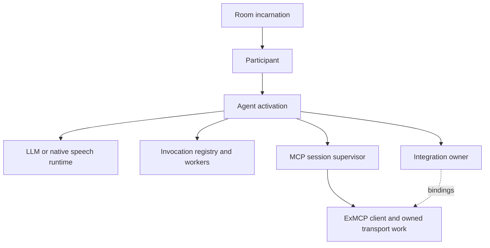

## Model and tool responsibilities

`vxpipe_agent_runtime` runs the streamed model/tool loop directly on ReqLLM.
Jido is not part of the current runtime. A Session owns per-activation model
context and repeated rounds; Call Engine owns call policy and tool effects.
The model adapter does not call tenant repositories or acquire room authority.

The activation's `ToolDescriptors` compile selected schemas alongside a private
`ToolRegistry`. Native STS receives only the wire-safe schema projection while
its runtime retains the same executable bindings used by LLM agents.
`InvocationRegistry` admits bounded work; `InvocationExecution` handles platform,
host, variable, transfer and MCP bindings.

Both paths check the exact participant/activation, selected name, arguments,
current permission and resource pins. A platform result can contain a local
effect, such as transfer or hangup, plus a public result; serializing the effect
as ordinary JSON would not perform the action.

## Activation-owned MCP sessions



The owner identity is a fresh local PID/reference, separate from saved connection
identity and credential authority. Tenant A's saved connection can be used by
call 1 through owner P1 and call 2 through P2. Restarting call 1 creates P3; a late
close/result for P1 cannot resolve to P3.

Only integrations selected by that activation are opened. Compatible aliases may
share a session within one activation, after endpoint, configuration, credential
pins and effective transport policy agree. Other calls/activations have separate
sessions. Catalog/tool pins and alias execution limits remain independent.

The owned tree includes asynchronous POST work, stream readers, reconnect/health
work and relevant credential-operation observers. ExMCP supplies the protocol;
Vxpipe supplies the caller's ownership and authorization policy. The tracked
patch under [`patches/ex_mcp`](../../../patches/ex_mcp) closes dependency transport
ownership/credential gaps and is applied by setup/CI.

Root registries and credential coordination remain shared. They do not pool live
call sessions. Bounded connection checks, OAuth operations and background catalog
refresh use explicit temporary operation owners outside calls.

## Startup, retirement and failure

Initialization and current credential checks complete before bindings become
ready. Failure opening a later integration must close every partially opened
child and lease. Network work stays off RoomAuthority and shared supervisor
startup callbacks.

Retirement closes admission first, rejects later submissions, then drains or
cancels owned work and transports. Transfer, disconnect, startup failure, owner
death and call shutdown all preserve this boundary. Process ancestry and monitors
enforce abrupt cleanup; best-effort session DELETE is not the correctness proof.

Client loss invalidates bound handles. Recovery uses the existing bounded
activation restart policy and a fresh owner, with revalidation. Never leave a
binding pointing at a replacement client or automatically replay a submitted
tool request. One activation's loss does not retire another call's session.

Local cancellation cannot undo an external mutation. Distinguish known rejection
before submission from an unknown result after submission. Credential revocation
blocks subsequent requests; an already accepted operation can still finish.

## Completion and conversation behavior

Blocking and non-blocking tools share admission, result validation, deadlines,
history visibility and usage. Blocking input is held/discarded rather than
replayed. Non-blocking results retain their invocation association while the
conversation proceeds.

Native completion crosses the semantic speech API with the correct response
context. A reversible output hold must not lose the completion lease. Release
requires evidence that the consumer accepted the result, not merely that a worker
sent it. Transfer/hangup may legitimately retire the source before a reply.

Duplicate protection is bounded to admitted/retained invocation identities.
Fresh references rejected before registry admission and evicted IDs are outside
that guarantee. Retention is not an exactly-once protocol for an arbitrary server.
Provider-specific encoding belongs in adapters; no provider implements a separate
executor or MCP authorization path.

## Tenant catalog cache

`SavedMCPCatalog` exposes cached tool metadata without decrypting credentials or
contacting servers. Compilation pins connection/configuration/catalog identity;
unsupported schemas are omitted from selection and rejected when selected
explicitly. Native-only specs do not require MCP storage.

Static save discovers the initial catalog. OAuth completion discovers it after
authorization/token exchange, including CIMD/DCR. Catalogs belong to each tenant
connection, since authorization changes the visible tools. A cache hit removes
per-call catalog discovery, not per-activation initialization or current request
authorization.

Oban lives in Persistence and invokes Calls' queue-independent maintenance ports.
The minute sweep selects bounded indexed batches; refresh workers resolve current
credentials and use temporary owned sessions. No database lock is held during
network discovery. Default expiry is one hour, with a 30-minute scheduling window,
batch size 100 and four catalog jobs per node.

Eligibility is:

```text
connected
and (refreshed_at missing or older than configured expiry)
and (refresh_scheduled_at missing or at least 30 minutes old)
```

Under a short row lock, recheck eligibility and insert the job plus timestamp in
one transaction. Matching queued/running/retryable work suppresses another job
even after 30 minutes. Oban uniqueness is a secondary guard; a uniqueness conflict
does not advance the timestamp. Retries, orphan recovery and pruning use Oban's
existing mechanisms.

Job arguments contain IDs, generation and scheduling timestamp, never secrets.
Execution rechecks status, pins and freshness. Complete discovery is published
only if those values and the previously observed `refreshed_at` still match.
Accepted publication advances freshness monotonically, even for an empty or
unchanged catalog. Failures retain the prior complete snapshot. A late job cannot
replace a newer manual refresh or revive a disconnected connection.

## Model context and compaction

Transient variable/pending-tool projections respect the active participant's
permissions. Compaction uses the pinned model, credential and accepted native
routing options; it does not choose a new recipient. Its bounded summary request
has no tools, variable projection or executor authority.

Accepted summaries remain untrusted assistant-role derived data inside the
Session. They never replace persisted transcripts or become system instructions.
Protected recent/context entries remain intact. Conservative byte-based budgeting
is not an exact provider tokenizer; unknown limits and oversized/invalid summaries
fail without recursively deleting protected content. Usage records the real
summary attempt separately. Automatic compaction is disabled by default.

## Tradeoffs and verification

A global connection pool would reduce handshakes but break call-owned lifetime
and isolate failures poorly. Per-activation sessions increase socket/initialization
cost in proportion to active selected integrations; cached catalogs, shared grant
coordination and bounded concurrency limit avoidable work. Synthetic load results
are not a hosted capacity guarantee.

Run [`bin/test-shared-tools`](../../../bin/test-shared-tools), focused ownership
and catalog-worker tests, and the [MCP protocol lanes](testing.md#mcp-protocols).
Verify actual worker/socket drainage, stale handles, partial startup, current
credentials and cross-tenant isolation rather than checking only parent PIDs.
