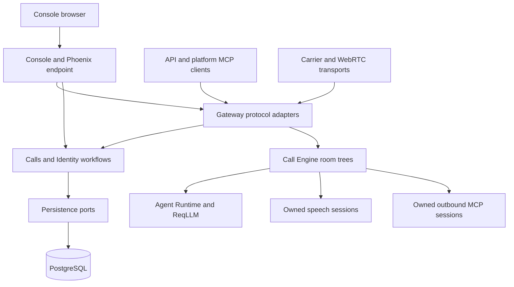

Vxpipe separates durable control-plane workflows from the processes that run a
live call. Console hosts the product UI and mounts Gateway in the same Phoenix
endpoint. There is one listener, with no internal HTTP proxy between them.

The diagram shows responsibility flow, not every compile-time dependency. Each
application's `mix.exs` enforces dependency direction.

## Application map

| Application | Responsibility |
| --- | --- |
| `vxpipe_console` | Phoenix host, browser sessions/pages, React assets, onboarding, operator inspection and browser OAuth orchestration. |
| `vxpipe_gateway` | Reusable HTTP/MCP adapters, WebRTC/RTVI, carrier protocols, admission/session supervision and durable-cleanup coordination. |
| `vxpipe_calls` | Database-neutral tenants, call specs, publication, preparation, provider/MCP authorization and archive workflows; repository ports. |
| `vxpipe_identity` | Accounts, permissions, browser identity, installation settings and authentication ports. |
| `vxpipe_persistence` | PostgreSQL/Ecto, transactions and constraints, encrypted records, OAuth adapters and Oban maintenance jobs. |
| `vxpipe_call_engine` | Protocol-neutral rooms, participants, media policy, turns, transfers, variables, speech and tool lifetimes. |
| `vxpipe_agent_runtime` | Per-activation model context and repeated model/tool rounds on ReqLLM. No room, tenant repository or carrier authority. |
| `vxpipe_mcp` | Outbound MCP protocol/transport policy around ExMCP, scoped clients and bounded discovery/OAuth operation hosts. |
| `vxpipe_providers` | Fixed provider manifests, credential schemas and capability declarations; implementations remain in their owning runtime application. |
| `vxpipe_artifacts` | Object-storage adapters for permitted recordings and call-detail artifacts. |

Gateway and Engine do not query Ecto Repo directly. Domain workflows receive
repository implementations from the host. Persistence implements those ports;
domain modules do not depend on PostgreSQL or the queue library. Protocol
adapters translate input/output and invoke the same workflows used by Console.

## From configuration to conversation

1. An authorized actor saves and publishes a call-spec revision. Compilation
   validates participants, resources, schema and permissions.
2. Preparation pins that revision and safe credential/catalog identities in a
   durable call record. Provider secrets stay out of the plan.
3. Gateway authenticates admission, starts a gated room and binds its exact
   incarnation before releasing startup effects.
4. The room constructs owned capabilities asynchronously. Readiness includes
   current bindings and media policy, not just process existence.
5. Caller input reaches permitted STT/model or native STS paths. Shared tool
   execution performs validated actions. Credited output reaches the chosen sink.
6. Authorized facts flow asynchronously to history, usage and optional artifacts.
   Shutdown ends owned runtime resources and records only evidenced outcomes.

See [Call runtime](call-runtime.md) and [Speech runtime](speech-runtime.md) for
ordering and failure contracts.

## Persistent and ephemeral state

PostgreSQL owns accounts, grants, encrypted credentials, call specs/revisions,
prepared calls, admission/cancellation records, permitted history, usage and
tenant MCP catalogs. Object storage holds optional artifacts.

Room incarnations own live participants, media allocations and active agent
resources. Each agent activation owns its requests, invocation workers and MCP
sessions. Shared registries locate opaque handles; they are not work queues or
owners that keep a retired session alive. Background catalog discovery has its
own temporary operation lifetime.

Call restart is not audio-session resumption. Archived facts and cancellation
intent survive an application restart; the live conversation does not move to a
replacement process automatically.

## Two MCP boundaries

Gateway serves the **inbound platform MCP** endpoint on the Console/API listener.
Its OAuth and protocol infrastructure may be application-owned because external
clients manage platform resources independently of a call.

The **outbound MCP clients** used by agents belong to activation trees. Their
tenant catalog and credential storage are shared data, while their transports
are isolated live resources. See [Agent runtime and MCP](agents-and-mcp.md).

## Embedding and delivery

An Elixir host can compose Engine without Console, or mount Gateway's Plug
interface without Phoenix. Mounting routes does not start its required runtime
supervisors. Disable Gateway's separate listener when another endpoint hosts it.
Names, origin policy and startup options belong to the embedding host.

The repository is currently an umbrella checkout. Independently packaged
dependencies, a complete consuming-host release and the Docker artifact remain
delivery work. Existing reusable boundaries do not establish a published package.

## Decisions and implications

- Keeping Phoenix in Console prevents a reusable call gateway from depending on
  UI assets and dashboard infrastructure.
- Domain-owned ports preserve authorization/transaction boundaries without a
  generic action dispatcher or internal HTTP service.
- Per-call ownership limits failure propagation. It costs per-call provider/MCP
  connections; bounded queues and cached catalogs avoid repeated discovery work.
- Asynchronous archival keeps storage off the live media path, but inspection
  must represent gaps and delayed completion honestly.

Current source boundaries are visible in [`apps/`](../../../apps). Acceptance
commands and evidence limits are in [Testing and verification](testing.md);
historical checkpoint results remain in [milestones](../../../labnotes/milestones/index.md).
