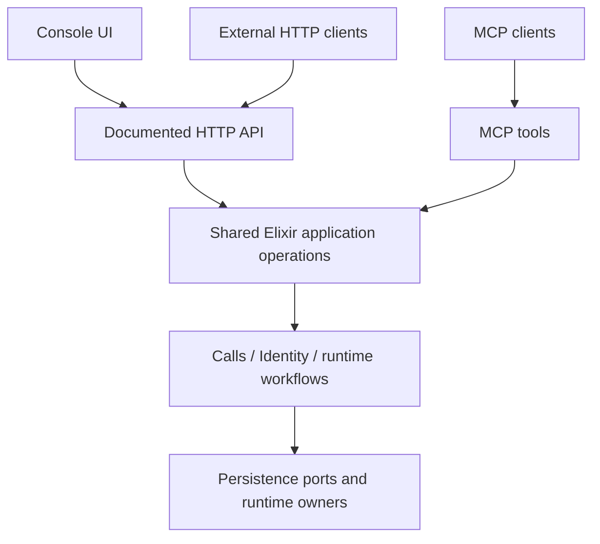

# Platform MCP endpoint

Status: tool catalog and OAuth authentication implemented and locally verified,
2026-10-16. Deployment is separate.
The [implementation milestone](../labnotes/milestones/platform-mcp-endpoint.md)
owns checkpoints and acceptance. This decision records the initial scope and its
authorization boundaries.

## Intended use

Connect an OAuth-capable MCP client to `https://YOUR-VXPIPE-HOST/mcp`. Vxpipe
uses its existing Console login to approve access. The client acts as the user,
within their approved role permissions and tenant access. Public HTTP clients
continue to use API keys; browser HTTP clients continue to use login sessions.

The [OAuth design](mcp-oauth.md) records discovery, public-client registration,
PKCE, consent, token lifetimes and revocation. The
[OAuth milestone](../labnotes/milestones/mcp-oauth.md) tracks cutover acceptance.

## Implemented tools

All 17 tools share the existing Elixir application operations:

- Tenant discovery: `list_tenants`, `get_tenant`.
- Specs and catalogs: `list_call_specs`, `get_call_spec`, `create_call_spec`,
  `update_call_spec`, `publish_call_spec_revision`, `list_providers`,
  `list_provider_models`.
- Calls: `create_call`, `create_join_token`, `hangup_call`.
- Accounts: `list_users`, `create_user`, `update_user`, `disable_user`,
  `list_role_options`.

Discovery follows the user's effective read/write permissions. Each invocation
independently checks authority and tenant/resource ownership. Read-only users can
use the applicable read tools; approval never grants write permissions or access
to another tenant. Admin cannot manage Admin or Superadmin accounts. The
[product HTTP API](product-http-api.md) documents corresponding HTTP operations.

The outbound `vxpipe_mcp` client library is separate from this inbound server.
ExMCP remains the server protocol implementation; Boruta processes OAuth through
Identity and Persistence adapters. No additional deployment is required.

## Shared application and HTTP API

User decision: the UI and external HTTP clients use one documented product API.
MCP invokes the same underlying Elixir application operations directly. Sharing
database tables or placing similar business logic in separate controllers does
not satisfy this contract.



The application API is a set of focused public context functions, not a new generic
dispatcher or a service deployment. Reuse the existing umbrella owners:

| Responsibility | Owner |
| --- | --- |
| Tenant/spec reads and writes, key authority, durable admission/claims | `vxpipe_calls` |
| Account policy and user lifecycle | `vxpipe_identity` |
| Preparing/starting/stopping transport-backed calls | Transport-neutral application workflows in `vxpipe_gateway`, composing Calls and engine/runtime owners |
| Repositories, transactions, actor revalidation and durable audit | `vxpipe_persistence` through domain-owned ports |
| HTTP parsing/authentication and MCP protocol envelopes | Thin adapters in Gateway, with Console supplying its browser-session integration |

No new umbrella application is required solely to provide a shared facade. Keep
functions grouped by domain rather than a large `API.execute(action, params)`
module. Each operation accepts a trusted actor and validated operation input,
returns `{:ok, result}` or `{:error, error}`, and owns its policy, validation,
pagination, transaction/idempotency and side effects independent of transport.
Use small typed request/result structures only where they clarify a real contract.

For example, both the HTTP handler and MCP handler invoke the same public
create-call workflow with actor, tenant_key, call_spec_id and call options. Neither
handler reimplements initial-variable validation, performs Repo queries, or chooses
an unscoped engine process. Direct Elixir callers receive the same authorization
checks; a controller's route-permission plug is not the sole guard.

Move reusable Identity dependency composition out of Console-only code into its
owning application's configured boundary. Keep Calls independent of Gateway and
Identity independent of Calls/Console; use ports and application-owned configuration
where machine-key validation requires persistence. Declare actual dependencies in
the owning child rather than relying on transitive access.

### One HTTP contract for UI and external clients

- Canonical product routes live under `/api`. The UI calls these same routes and
  receives the same schemas, pagination, validation errors and response shapes
  as documented external callers. Public does not mean anonymous.
- The current split between `/admin/api` Console handlers and machine-only `/api`
  handlers is migration work. Migrate each overlapping workflow to one canonical
  handler/schema, update UI callers/types/fixtures, and retain necessary legacy
  aliases only as thin compatibility adapters. Do not document one route while
  leaving the UI on an independently implemented private equivalent.
- Preserve existing published `/api` contracts where possible; document and use
  them from the UI. If evolution is needed, specify the additive/versioned migration
  before changing consumers. Existing fields such as `source` are not renamed
  merely to match an Elixir function argument or tool label.
- Inventory all UI requests, not just the MCP subset. Tenant/spec/call/user
  operations, services, roles and key management are product operations, not
  automatically UI-only because they currently live under `/admin/api`. Classify
  and document their canonical routes and machine/session authorization. This
  HTTP consolidation does not add extra MCP tools beyond the reviewed catalog.
- UI-specific helpers may include session/navigation information and page-oriented
  lookups/aggregates. Keep them few, explicitly classified, and composed from the
  same authorized application reads. Login/setup/recovery/CSRF are separate browser
  authentication mechanics. A UI helper must not become a second write path or
  evade public operation permissions.
- One HTTP documentation/schema source covers canonical operations and their
  allowed credential types. Reuse existing schema tooling if available; avoid a
  parallel handwritten API schema for the UI and another for external users.
  MCP schemas adapt these inputs/results and add protocol metadata; they do not
  independently define business validation.

### Authentication and authority

Browser UI requests use the existing session cookie and CSRF protection for unsafe
methods. External HTTP callers use API keys; MCP clients use OAuth. Never put a
platform key in the browser bundle or mint a machine key merely to make the UI use
the public API.

The shared HTTP boundary obtains an actor from configured authentication adapters.
Console supplies session authentication/CSRF integration without making Gateway
depend on Console; standalone Gateway can expose the same routes with Bearer-only
authentication. The same HTTP operation implementation serves both deployments.
Explicit Authorization selects key authentication; an invalid/unsupported header
does not fall back to a more privileged cookie. Without Authorization, the browser
session path applies its CSRF/origin protections. Never union key and session grants.
MCP accepts OAuth access tokens only, including on the Console host.

Authenticated actors retain their real provenance: browser user/session or machine
key. Shared policy checks each actor's existing grants/key type, tenant membership
and ownership. Equivalent authority gives equivalent behavior, not every browser
user and every API key the same access. Account writes revalidate the appropriate
actor in the transaction and audit that actor, without fabricated browser sessions.
OAuth actors retain the real user and grant identity; their browser-session field
is empty. Current and approved authority are checked independently.

Acceptance must cover the same operation via direct Elixir, browser-session HTTP,
API-key HTTP and MCP, including denied/foreign resources, initial variables,
pagination and mutation effects. Browser inspection and network verification must
show the UI actually using the documented endpoints. Testing only HTTP and MCP
while retaining the old UI path is incomplete.

## Required tool catalog

Use the names below. `tenant_key` is the public identifier already stored in `tenants.key` and used by
our HTTP routes/authentication. Reserve `tenant_id` for the internal database
primary/foreign key; do not accept it as a public alias. The key is an identifier,
not an authentication secret. Spec, call and user IDs mean their existing public
identifiers. Reject unexpected fields and client-supplied authority.

Use `tenant_key` in MCP arguments, new machine API arguments and new tenant response
objects, including user membership entries. Existing REST responses that expose
`key` remain compatible; old Console payloads can be supported during the UI's
cutover by thin legacy aliases. The final UI uses the documented canonical shapes,
without a browser-specific variant of the same endpoint. This introduces no new
tenant identifier and requires no tenant data migration. Use `get_tenant` for the
proposed tenant-info tool to match `get_call_spec` naming.

Require `tenant_key` for every tenant-specific operation, even when the credential
already identifies one tenant. This keeps one client/tool schema for delegated
users and HTTP keys, makes the intended target visible, and prevents an implicit
selected tenant from changing the meaning of a call. The actor must have authority
for that tenant; naming it never grants access. Validate every supplied spec/call/participant
against the selected tenant as well. Wrong-tenant and unknown resource IDs share
the not-found response. The argument selects a resource context, never authority.
`list_tenants` and installation-wide user/role operations do not take `tenant_key`.

| Tool | Arguments | Result and behavior |
| --- | --- | --- |
| `list_tenants` | `page`, `page_size` | Paginated `{tenant_key, name, created_at}` records visible to the user |
| `get_tenant` | `tenant_key` | `{tenant_key, name, created_at}` for one visible tenant; no service secrets |
| `list_call_specs` | `tenant_key`, `page`, `page_size` | Paginated spec summaries with ID, latest revision and published revision |
| `get_call_spec` | `tenant_key`, `call_spec_id`, optional `revision` | Portable definition, selected/latest/published revision metadata; latest saved revision by default |
| `create_call_spec` | `tenant_key`, `call_spec_definition` | New server-generated `call_spec_id` and draft revision |
| `update_call_spec` | `tenant_key`, `call_spec_id`, `call_spec_definition` | Append an immutable draft revision to that existing spec |
| `create_call` | `tenant_key`, `call_spec_id`, optional `variables`, `to`, `idempotency_key` | `{call_id}`; pin the published spec and validate initial variables before admission |
| `create_join_token` | `tenant_key`, `call_id`, optional `participant_key`, `join_token_ttl_seconds` | Token, expiry and resolved participant key for that call |
| `hangup_call` | `tenant_key`, `call_id` | `{call_id, status}` with `ending` or `ended`; terminate the whole call |
| `list_users` | `page`, `page_size`, optional `query`, `role_id` | Paginated safe user records, including ID, email, role, enabled state and memberships |
| `create_user` | `email`, `password`, `password_confirmation`, `role_id`, optional `memberships` | Created enabled user, without passwords or hashes |
| `update_user` | `user_id`, supplied fields among `email`, `role_id`, `memberships`, `enabled` | Updated user; `enabled: true` activates/reactivates the account |
| `disable_user` | `user_id` | Disabled user; repeat-safe, no hard deletion |

These are JSON object arguments, not positional function calls. Optional fields
and defaults are defined below; unspecified fields are required. The target
`call_spec_id` belongs outside the portable definition on updates.

Supporting tools complete the authoring workflow:

- `publish_call_spec_revision(tenant_key, call_spec_id, revision)`: publication stays
  explicit. Create/update must not silently activate a draft or place calls.
- `list_providers(tenant_key, capability, page, page_size)` and
  `list_provider_models(tenant_key, provider, capability, page, page_size)`: existing
  local provider/model discovery, now with paginated MCP/API projections.
- `list_role_options(page, page_size)`: safe role IDs/names/kinds so a client can
  create/update users without guessing IDs; no role editing tools.

These four helpers are distinguished from the 13 user-requested operations.
Platform status is no longer a proposed product tool; protocol ping remains.
No MCP tools for services/credential management, API-key issuance, role editing,
call-history listing, recording downloads or carrier callbacks are added here.
Existing UI product HTTP operations are still covered by the shared-API inventory
and consolidation requirement above.

## Argument and result details

Each implemented tool takes a JSON object with `additionalProperties: false`.
The portable spec and variables have their own existing schema/validation rules,
not a blanket restriction on their nested property names.

| Argument | Type and behavior |
| --- | --- |
| `tenant_key` | Required on tenant-specific tools; existing 16-character URL-safe key |
| `call_spec_id` | Required on spec get/update/publish and call creation; existing public spec identifier |
| `call_id` | Required on token/hangup; existing public call identifier |
| `user_id`, `role_id` | Public user/role UUIDs, never database IDs; role_id required on user creation, optional on update/filter |
| `page`, `page_size` | Optional integers; defaults 1 and 25, page_size maximum 50; no numeric-string coercion in MCP |
| `revision` | Optional positive integer on get, default latest saved revision; required on explicit publish |
| `call_spec_definition` | Required complete portable source object on create/update; update is replacement of source in a new immutable revision, not a JSON patch |
| `variables` | Optional object on create_call, default `{}`; validate supplied sections with existing declared schemas and access rules; omitted sections retain existing `nil` semantics |
| `to` | Optional E.164 string on outgoing create_call; required for a dynamic destination, rejected for a fixed destination or a web-prepared call |
| `idempotency_key` | Optional nonblank UTF-8 string, 1–256 bytes, on create_call; client-generated and reused for the same intended creation |
| `participant_key` | Optional published route key on create_join_token; resolve the pinned eligible web entry if omitted; not a participant's display label |
| `join_token_ttl_seconds` | Optional integer, default 300, range 300–86,400, preserving current admission limits |
| `email` | Required on create_user, optional on update_user; existing normalization/uniqueness rules |
| `password`, `password_confirmation` | Required input-only strings on create_user; existing password policy and matching confirmation; unsupported on update_user |
| `memberships` | Optional array of `{tenant_key, access}`; default `[]` on create, unchanged if omitted on update; supplied array replaces assignments, `[]` clears them; access is `read` or `read_write`; duplicate tenants rejected |
| `enabled` | Optional boolean on update_user; true activates, false disables, omission leaves status unchanged; null/string values rejected |
| `query` | Optional string on list_users, using the existing bounded account-search rules; absent means no search filter |
| `capability`, `provider` | Required on the appropriate supporting catalog tools; existing capability enum and provider identifier, no arbitrary upstream endpoint |

`update_user` requires at least one change field; every supplied field is validated.
Changing roles must validate the resulting memberships and both old/new account
categories. No implicit role change, assignment deletion or activation is permitted.
Creation returns an enabled user; creating initially disabled accounts is not an
additional flag in this proposal. `disable_user` only changes enabled state and
performs existing session revocation.

| Tool/result group | Structured result |
| --- | --- |
| All list tools | `{items, pagination}` using the envelope below |
| Tenant list item / get_tenant | `{tenant_key, name, created_at}` for both |
| Spec list item | `{call_spec_id, latest_revision, published_revision}`; published_revision may be null |
| get_call_spec | `{call_spec_id, revision, latest_revision, published_revision, call_spec_definition}` |
| Spec create/update | `{call_spec_id, revision, validation_errors}`; retain current draft-save/compiler-error semantics; neither implicitly publishes |
| Spec publish | `{call_spec_id, published_revision}` after successful publication |
| create_call | `{call_id}`; failures preserve bounded admission/submission error codes |
| create_join_token | `{call_id, participant_key, token, expires_at}`; expiry is an ISO 8601 UTC timestamp |
| hangup_call | `{call_id, status}` where status is ending or ended |
| User list item / create/update/disable | `{user_id, email, role_id, enabled, memberships}`; memberships use public tenant keys |
| Role option item | `{role_id, name, kind}`; kind is admin, superadmin, or null for an ordinary role, matching existing role options |
| Provider/model item | Existing safe catalog fields, preserving provider/model IDs, capability availability and voice options |

The response shapes above are for MCP and corresponding new public projections.
Existing REST response bodies keep their compatible field names/envelopes; the UI
adopts those documented contracts. Compatibility aliases may preserve old Console
payloads during migration. Do not maintain different canonical response schemas
based on whether the caller is the UI or an external client.
No password, password hash or stored API-key material is returned by any tool.

## Pagination

Every product `list_*` operation, including supporting discovery/role lists, accepts
`page` (1-based, default 1) and `page_size` (default 25, range 1–50). Return:

```json
{
  "items": [{"tenant_key": "PUBLIC_TENANT_KEY", "name": "Example", "created_at": "2026-10-15T00:00:00Z"}],
  "pagination": {"page": 1, "page_size": 25, "total": 1, "total_pages": 1}
}
```

Apply authorization and filters before counts and pagination. Use a stable sort
with a unique public-ID tie-breaker; page 1 of an empty directory returns an empty
list with zero totals/pages. Invalid pagination returns a validation error; a page
above `max(total_pages, 1)` returns `page_out_of_range`. Query the database with
bounded limit/offset rather than materializing all users/tenants/specs. Small static
provider catalogs may be paginated after their permission-filtered projection.
Page-based lists are not snapshots across concurrent writes; document this limit.
MCP `tools/list` has its own protocol cursor rules, separate from product pagination.

## Access levels and shared API extensions

MCP delegates the signed-in user's existing role. The single `mcp` OAuth scope
adds no permissions. Current permissions are bounded by the consent snapshot;
finite tenant assignments stay finite, while approved all-tenant actions include
future tenants. Changing the user's role, membership, password or enabled status
invalidates existing grants. Changes to a role's revision also require consent
again. Logout only ends the browser session.

The existing API-key access levels remain available to the product HTTP API:

| HTTP key | Tenant visibility | Spec/catalog operations | Call operations | Account operations |
| --- | --- | --- | --- | --- |
| Create & Join Calls | Own tenant | No | Own tenant | No |
| Full Tenant Access | Own tenant | Own tenant | Own tenant | No |
| Full Platform Access | All tenants | Selected tenant | Selected tenant | Installation-wide |

All transports use shared policy and transaction-time write guards. OAuth account
changes audit the user and grant; API-key changes retain key attribution. A user
cannot expand authority by supplying actor fields or tenant IDs in tool arguments.

Partial `update_user` preserves omitted `enabled`, role and membership fields.
Memberships use `{tenant_key, access}`, where access is `read` or `read_write`.
Reactivation does not restore old sessions or OAuth grants. Password reset is not
part of `update_user`; creation passwords are input-only and never echoed.

## Call creation, variables and publication

`create_call` uses `call_spec_id`, not a participant route as its primary identifier.
Resolve the tenant-owned published revision and pin it once, including when a
concurrent publication occurs. `variables` is the initial Call Variables object:
validate declared sections, types and access rules before storing/admitting/dialing;
preserve values without coercion or logging. Omission uses the existing empty/default
behavior. It is not metadata and must reach the runtime's initial variables unchanged.

```json
{
  "tenant_key": "PUBLIC_TENANT_KEY",
  "call_spec_id": "PUBLIC_CALL_SPEC_ID",
  "variables": {"customer": {"name": "Dana"}},
  "idempotency_key": "client-generated-request-id"
}
```

For a published web-joinable incoming spec, create a durable prepared call and
return `{call_id}`. The call starts when a participant redeems a join token through
the existing session API. Resolve the entry caller from the published spec; do not
select the first route or trigger a carrier callback. A carrier-only incoming spec
cannot be synthetically received: return an explicit unsupported-entry error.

For an outgoing spec, reuse outgoing admission/dial submission and its `to` rules,
then return `{call_id}` after submission acknowledgement. This is not proof that the
callee answered. `to` is conditional on the spec's fixed destination; it never
comes from initial variables. Preserve bounded validation/submission errors.

Retain outgoing optional `idempotency_key` semantics and extend the shared claim
contract to prepared calls so the same public tool has consistent lost-response
recovery. The same tenant, idempotency key, spec, destination and variables replay the same call without
an extra dial; changed input conflicts. The existing tenant-wide idempotency
namespace must cover both paths without collisions. Failed/unknown submissions
retain their recorded outcome; replay never silently starts another attempt.
Without a key, separate invocations create separate calls. JSON-RPC IDs are not
idempotency keys. No automatic mutation retries.

The spec create/update tools map `call_spec_definition` to the existing portable
`source` contract. Updates require an existing tenant-owned ID and append a revision;
publication stays separate. `get_call_spec` returns portable source as `call_spec_definition`, never
compiled plans or resolved credentials. Definitions are checked for private material
under the same rules as REST.

## Join-token and hangup behavior

Join tokens remain participant-bound. With no `participant_key`, resolve the call's
pinned web-joinable entry caller. If it has no suitable default, require an explicit
participant selector; do not guess another participant. An explicit key must belong
to this call's pinned routes and be eligible for admission. Subsequent publication
must not change token eligibility for this call. Return the resolved participant
key so the client can use the existing session endpoint.

Reuse single-use token storage, TTL bounds and ended-call denial. Tokens are
intentional sensitive results; keep them out of logs, telemetry and audit summaries.
MCP authenticates with the OAuth access token, while token redemption/media negotiation stay
on the existing transports. It does not open audio streams itself.

`hangup_call` is a new authorized application workflow. Resolve tenant ownership
and the exact live incarnation server-side, then request whole-call shutdown through
its owner. Do not simply mark a database row ended or call an unscoped process kill.
Prepared calls must become terminal and their tokens unusable; admitting calls need
an atomic cancellation/admission interlock so shutdown cannot race a new live room.
Running/ringing calls must release all participant sessions and carrier legs through
existing cleanup owners. Never terminate a replacement incarnation using stale data.

A durable shutdown acceptance can return `ending`; return `ended` only with terminal
evidence. Already-ended calls return `ended` without new effects. Foreign/missing
calls return the same not-found shape. If the room is missing with no durable
terminal evidence, return a bounded unavailable/unknown outcome, not false success.
Test cleanup and archival/usage completion with local fake adapters. Do not label an
API-requested hangup as a remote-party hangup if the existing engine entry point
would produce that misleading reason.

## REST parity and ownership inventory

Add routes in the existing `/api` namespace using the shared application operations:

| Machine route | MCP operation(s) | Existing behavior to reuse/extend |
| --- | --- | --- |
| `GET /api/tenants`, `GET /api/tenants/:tenant_key` | Tenant list/info | Scoped tenant directory and safe tenant projection |
| `GET /api/tenants/:tenant_key/call-specs[/:id]` | Spec list/get | Existing Console/domain reads, now machine-authorized |
| Existing spec POST/PUT/publish routes | Create/update/publish spec | Immutable authoring and installation-service ownership |
| `POST /api/tenants/:tenant_key/call-specs/:id/calls` | Create call | Existing outgoing endpoint extended to web preparation |
| `POST /api/tenants/:tenant_key/calls/:id/join-tokens` | Create join token | Existing participant-specific issuer with pinned default resolution |
| `POST /api/tenants/:tenant_key/calls/:id/hangup` | Hang up call | New authorized workflow over durable admission and runtime owners |
| `GET/POST /api/users`, `PATCH /api/users/:id` | User list/create/update | Identity policy, password hashing, transactional guards and audit |
| `POST /api/users/:id/disable` | Disable user | Same partial-update workflow with enabled=false |
| `GET /api/role-options` | Role options | Safe role discovery, no role administration |
| Existing provider/model GET routes | Provider/model lists | Local catalog; add optional paginated projection compatibly |

Keep existing participant admission routes and outgoing responses compatible:
MCP projects the minimal `{call_id}` result from the shared domain result; existing
REST callers keep their response shapes. Do not create a separate outgoing path or
require existing clients to rename body `source`/`variables` fields. Existing catalog
clients without pagination retain their current response shape; pagination is a
shared opt-in REST projection and the standard MCP list shape. New machine routes
and MCP must have identical authorization and side effects.

## Protocol and ownership

Use the existing pinned ExMCP public server/Plug interface in Gateway, with a
direct dependency in that owning child and the shared lockfile. Calls continues
to own key authorization and call workflows; Identity owns account policy;
Persistence owns lookup/storage and transactional actor revalidation.
Console composes the mount and browser authentication adapter. Do not add a Calls/Gateway dependency to the
outbound `vxpipe_mcp` child, introduce an HTTP loopback proxy, or build a new MCP
protocol implementation.

Use the repository's existing MCP `2025-11-25` profile. The product boundary
rejects other revisions even though the dependency supports more versions.
Local Plug tests demonstrate initialization, notifications, ping, grant-bound
sessions, deletion and request-worker cleanup. The isolated
[server acceptance runner](development/platform-mcp-acceptance.md) also verifies
the official SDK against all three mounts and selected official conformance
scenarios; this is not full protocol or OAuth certification.

Use Streamable HTTP with JSON tool responses, initialization, initialized
notification, ping, tool discovery and invocation. No unsolicited event stream:
GET returns 405. ExMCP sessions are bound to the authenticated OAuth grant identity,
have bounded count/lifetime, and reauthenticate every request. No durable session
storage or event replay is needed. Local acceptance covers session deletion and
version negotiation.
See the [transport specification](https://modelcontextprotocol.io/specification/2025-11-25/basic/transports)
and [lifecycle specification](https://modelcontextprotocol.io/specification/2025-11-25/basic/lifecycle).

Current defaults are 64 concurrent HTTP requests, a 128 KiB request body, a
five-second body-read timeout and a ten-second handler deadline for ordinary
operations. Authorized `create_call` requests have a separate 100-second deadline
because outgoing submission can wait up to 35 seconds plus a 60-second ring bound.
Configure the MCP client's request timeout above that deadline when using outgoing
creation. A timeout or lost response is not evidence that no call was created:
recover using the original idempotency key and input; never retry with a new key
automatically. The server setting is `call_creation_timeout` in milliseconds;
installations that increase `outgoing_start_timeout_ms` must increase the creation
and client deadlines accordingly. Handler cleanup can add approximately one second. JSON-RPC IDs are strings of at most 256 bytes
or integers in the inclusive range -9007199254740991 through 9007199254740991.
Rejected oversized IDs are not echoed. Unknown valid notifications receive no
JSON-RPC response body.

The selected ExMCP session manager is node-local and shared: its current defaults
are 10,000 sessions, 10,000 distinct request IDs per session, a one-hour idle TTL
and cleanup every 60 seconds. These are dependency defaults, not per-grant quotas;
the isolated runner verifies accelerated idle expiry and full BEAM restart on the
same port, followed by fresh-session recovery. Request owner death releases
Gateway admission and terminates the request handler. These checks do not claim
immediate cancellation on every TCP disconnect. Clients must still supply
their OAuth access token on subsequent requests, and use fresh request IDs within a session.

Advertise tools only: no resources, prompts, subscriptions, sampling, elicitation,
task extensions, audio streams, or outbound MCP proxy. Provide strict schemas,
bounded results, structured content plus a text representation, and accurate
read-only/destructive/idempotency annotations. Protocol-envelope failures are
JSON-RPC errors; resource visibility and ordinary domain failures are tool results
with `isError: true`. Credential failures and operation-level permission denials
remain HTTP failures. Pre-dispatch scope checks must use the shared application
policy, not a second MCP-specific permission matrix. Follow the
[tool specification](https://modelcontextprotocol.io/specification/2025-11-25/server/tools).

## Authentication contract and client compatibility

MCP uses OAuth authorization-code flow with S256 PKCE, dynamic public-client
registration and rotating refresh tokens. Configure the client with the MCP URL;
it discovers the authorization server and opens the Console login/consent page.
There is no API-key tool argument, login tool, client secret or cookie fallback.
Clients requiring Client ID Metadata Documents without a DCR fallback are not
supported by this initial profile. See [OAuth configuration and limits](mcp-oauth.md).

Every request supplies exactly one credential:

```http
Authorization: Bearer <OAuth access token>
```

Missing credentials return 401 with a Bearer challenge containing the canonical
`resource_metadata` URL and `scope="mcp"`. Invalid, expired or revoked credentials
also include `error="invalid_token"`. Duplicate/malformed credentials return 400;
unavailable authentication storage returns 503. These failures never redirect to
login or reveal another user's resources. Valid tokens lacking an operation's
permission receive 403; ordinary domain failures retain safe tool-result mapping.

Initialization, notifications, ping, discovery, invocation and session deletion
all reauthenticate. A session ID grants no authority. Refresh preserves its grant
identity and can continue the MCP session; another grant cannot reuse that session.
Revocation prevents the next request, including requests on established sessions.
Already admitted calls keep their existing lifecycle and are not cancelled by
revoking the OAuth grant.

### Client setup and migration

For a client supporting discovery and DCR, configure only the server URL:

```json
{
  "mcpServers": {
    "vxpipe": {
      "type": "http",
      "url": "https://YOUR-VXPIPE-HOST/mcp"
    }
  }
}
```

Complete its browser login and approve the displayed client/callback/access.
Keep access and refresh tokens in the client's credential store, outside prompts
and source control. Revoke a connection from Account when it is no longer needed.

Existing static-key MCP configurations must remove their Authorization override,
reconnect and complete OAuth. Existing MCP sessions cannot be reused across this
cutover. HTTP API keys remain valid on their documented product routes; this
migration does not rotate or revoke them.

## Authorization and operational implications

Issuer and resource come from trusted runtime configuration. The normal Console
issuer is its configured application origin; its default resource is that origin
plus `/mcp`. `VXPIPE_MCP_RESOURCE_URL` can select the exact public resource URL for
an embedding mount. Configure matching host/origin handling and ensure the public
route reaches that mount. Never derive either URL from incoming Host headers.

Each request loads current authority and applies the approved delegation ceiling.
Invocation uses shared Calls/Identity policy, and account writes revalidate inside
their database transaction. Do not retain a raw token in MCP session state, accept
client-supplied authority or share one request's principal with another request.

Gateway mounts MCP before generic body parsing; Console supplies the OAuth browser
flow. HTTPS is required outside loopback development. Discovery/token endpoints
have bounded bodies, timeouts, quotas and durable rate limits; responses use
`no-store`. No broad credentialed CORS or query-string bearer credentials are used.

## Verification

The [server acceptance runner](development/platform-mcp-acceptance.md) uses the
pinned official SDK, local PostgreSQL and synthetic accounts/calls across all three
mounts. It does not call voice providers or carriers. The OAuth milestone records
actual exchange, race, consent, authority, browser and cutover acceptance evidence;
do not treat a protocol test as blanket OAuth certification.
