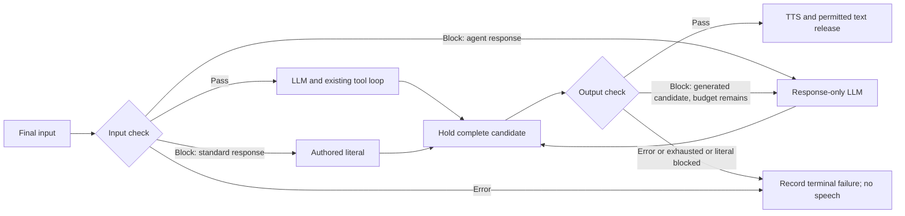

# Voice agent input and output guardrails

Status: research/specification complete; implementation **not started**. Requested
2026-11-11. All implementation and acceptance checkboxes remain unchecked. The
contracts below are proposed implementation decisions, not user approval of each
default or evidence that guardrails already work.

## Runnable outcome

An operator enables guardrails for an LLM + TTS participant, inherits the call's
guardrail model or selects another, and authors separate input/output questions
with **Confidence threshold** values. A live voice or text turn is evaluated before
the conversational model sees its input. A rejected input produces either a
model-authored response to structured guardrail feedback or an authored response
that bypasses that model. Enabled output checks hold each complete response,
request a bounded rewrite when necessary, and release only accepted text to TTS
and ordinary client transcript delivery.

The authorized call transcript and debug inspection show the original input,
every input/output evaluation, blocked drafts, feedback, replacements and delivery
outcomes, subject to existing transcript permissions. Both Jev and OpenAI Decisions
must work through the same contract. Native speech-to-speech checking is deferred.

## Prerequisites and design sources

Read the [guardrail decision and research](../../docs/design/voice-agent-guardrails.md),
[current call-spec contract](../../docs/en/usage/call-specs.md),
[agent/runtime boundary](../../docs/en/development/agents-and-mcp.md),
[speech lifecycle](../../docs/en/development/speech-runtime.md), and
[provider ownership](../../docs/en/development/providers-and-integrations.md).

Direct prerequisites are the implemented
[ReqLLM runtime](reqllm-agent-runtime.md),
[speech sessions](simpler-speech-integrations.md),
[provider manifests](provider-integration-packages.md),
[tenant credentials](tenant-provider-credentials-and-platform-configuration.md),
[call-spec editor](call-spec-editor.md),
[asynchronous history](asynchronous-call-history.md),
[call inspection](call-inspection-and-debugging.md), and
[shared tool execution](shared-participant-tool-execution.md).
Use the existing database inspection host from
[call debug console](call-debug-console.md); its unfinished live chat/voice controls
are not prerequisites. This milestone owns its guardrail projection and UI changes.
All these entries occur earlier in the index. Packaging, retention implementation,
native-audio acceptance and unrelated deferred issues do not block this slice.

## Configuration contract

### Selection, enablement and migration

- Add `guardrail` to `defaults.capabilities` and participant `capabilities`, resolved
  by the same whole-selection override as speech capabilities. It selects an
  evaluator, independent of `model_inference` and `text_to_speech`. Both input and
  output sections use that participant's effective selection in this milestone.
- Add participant `guardrails`, default absent/disabled. `enabled` defaults false;
  each direction's `enabled` defaults false. When the overall switch is on, at
  least one direction must be enabled, with at least one question. Disabled
  sections retain valid draft settings but perform no calls or credential lookup.
- Questions and actions belong to the participant, not call defaults. A call
  default evaluator never enables guardrails implicitly. Participant omission
  inherits; an explicit selection must contain provider, model and credential
  binding together. An explicit `null` selection is invalid, as for existing
  capability selections; remove the override to inherit.
- A guarded participant requires `model_inference`. Enabled guardrails on human
  participants or `speech_to_speech` fail at the relevant source path. LLM text-only
  participants may use the same checks; fixed responses then use text delivery.
- Add provider ID `typesafe` for Jev and a `guardrail` manifest capability on it
  and existing `openai`. Initial suggested models are `jev-1.14.0` and
  `gpt-6-luna`, respectively, subject to revalidation before implementation.
  Do not offer arbitrary chat models for this capability. Prefer versioned IDs;
  if a supported moving alias is explicitly chosen, preserve it and record the
  actual response model. Never silently choose another provider or model.
- Reuse encrypted tenant credential bindings and platform inheritance; selection
  identifies a saved binding, never a secret. Add the new credential schema and
  provider validation/catalog support. A valid OpenAI key alone does not prove
  account access to Decisions; provide a separate capability check.
- Reject unknown fields, transport overrides, endpoint URLs, auth headers,
  unsupported options/models, missing effective selections and unavailable
  bindings. Return the editor/API's normal field-path errors. Resolve credentials
  only for enabled use, in owned startup/request work.
- Introduce a new call-spec schema version for these additive fields, with the
  exact version allocated during implementation. Continue reading published
  `20261004.01` specs with guardrails disabled and without rewriting their source,
  digest or plan identity. Saving an edited spec creates a new immutable revision;
  prepared/running calls keep their original policy/model/question snapshot.

Proposed **fragment** of a call spec, not a runnable full spec:

```json
{
  "defaults": {
    "capabilities": {
      "guardrail": {
        "provider": "openai",
        "model": "gpt-6-luna",
        "credential_name": "guardrails-primary"
      }
    }
  },
  "participants": {
    "support_agent": {
      "guardrails": {
        "enabled": true,
        "input": {
          "enabled": true,
          "questions": [
            {
              "id": "requests_private_information",
              "question": "Does the current message request another customer's private information?",
              "confidence_threshold": 0.70
            }
          ],
          "on_block": {"action": "agent_response"}
        },
        "output": {
          "enabled": true,
          "questions": [
            {
              "id": "discloses_private_information",
              "question": "Does the candidate response disclose another customer's private information?"
            }
          ],
          "max_regenerations": 2
        }
      }
    }
  }
}
```

An explicit participant selection replaces the inherited selection with, for
example, `{"provider":"typesafe","model":"jev-1.14.0","credential_name":"guardrails-secondary"}`.
To skip the conversational model on input rejection, use this `input.on_block`:

```json
{
  "action": "standard_response",
  "response": "I cannot share another customer's information. I can help with your own account."
}
```

`agent_response` is the default input action. `response` is required and nonblank
only for `standard_response`; reject mismatched fields. The action is per input
section, so simultaneous rule matches cannot choose conflicting actions. Every
matching question is reported. Output rejection always uses the rewrite contract
below, with `max_regenerations` default 2, integer range 0–3.

### Questions and confidence thresholds

- Each question has a stable participant-unique `id` matching
  `[a-z][a-z0-9_]{0,63}`, a nonblank `question` of at most 1,024 UTF-8 bytes, and
  optional `confidence_threshold`. IDs survive edits/reordering and serve as
  feedback codes. Do not generate atoms from them.
- Phrase questions so **yes means a blocking condition**, for example “Does this
  response expose a secret?” The editor explains this polarity. Do not silently
  invert positively phrased safety questions. No implicit built-in question list.
- Default threshold is `0.70`. Accept numeric values from `0.00` through `1.00`
  in hundredth increments. `0`, `0.7`, `0.70`, `0.57` and `1.00` are valid;
  canonical editor display is two decimal places. Reject negative/out-of-range
  values, strings in the JSON API, booleans, nonfinite values and values with more
  than two fractional decimal places. Empty editor input resolves to the default
  on save, not zero. Do not round invalid authored thresholds into range.
- Parse decimal values exactly and store the threshold internally as integer
  hundredths. Compare the full provider probability against that threshold,
  without rounding the probability for display first. Avoid binary floating-point
  equality as the validation rule. `p >= threshold` blocks; ANY match blocks.
  With threshold `0.00`, every valid answer matches, including zero; `1.00`
  matches only one. Warn helpfully about these meanings without rejecting them.
- Keep the product label **Confidence threshold**. Help text: “Block when the
  estimated probability that this condition is true meets this value.” The
  normalized result is `violation_probability`; never threshold a vendor choice
  confidence, a severity score or certainty of a negative answer.
- Limit each direction to 32 questions and 16 KiB total question text. Use authored
  order for display/feedback only, not short-circuit evaluation. Validate all
  answers; retain all matching IDs. These are Vxpipe bounds, not vendor limits.

## Evaluation boundary and provider contract

Call Engine owns `Guardrails` policy/state and activation-owned evaluator workers.
Provider manifests/credential descriptors stay in `vxpipe_providers`; HTTP adapters
live under their provider namespaces in Call Engine. Use existing HTTP facilities
with explicit timeout/retry settings; no new agent framework is required.

The provider boundary accepts an immutable request containing effective selection,
private credential material, direction, named questions, permitted context, exact
current text and an absolute deadline. It returns the actual model, a map of named
finite probabilities in `[0,1]`, usage if available and safe transport metadata, or
a typed error. The common policy layer owns threshold comparison and action choice.
The adapter cannot release speech, execute tools, change permissions or write SQL.

| Adapter | Request encoding | Normalized answer |
| --- | --- | --- |
| Jev | Bearer-authenticated `POST https://api.typesafe.ai/v1/systemone`; `model`, structured `state`, `questions` map keyed by question ID, each `type: "noul"` with question instructions. | `answers[id].noul`, requiring the matching `type`. |
| OpenAI Decisions | Bearer-authenticated `POST https://api.openai.com/v1/decisions`; `model`, `input` containing the serialized shared evidence, and a `questions` array of `{name, type: "predicate", instructions}`. | Map `answers` by `name`, require `type: "predicate"`, then read `probability`. A per-question refusal is an error. |

Official contracts and model evidence are linked in the
[research decision](../../docs/design/voice-agent-guardrails.md#research-evidence).
Do not use a same-named third-party gateway for Jev or substitute moderation/chat
endpoints for Decisions. Request examples in tests must match current first-party
schemas; classify synthetic text only in provider checks.

Require exactly one usable answer for every requested ID, no duplicate/unknown IDs,
correct types and finite in-range numeric values. No coercion of strings or booleans,
default-zero answers, missing-answer pass, fabricated explanation or silent clamp.
An incomplete/refused/malformed batch has overall status `error`, even if another
answer matched. Retain trustworthy individual outcomes for inspection, but do not
invoke the input block action or output rewrite on an incomplete evaluation.

Evidence includes direction, target participant, current source participant and
text, plus up to four recent permitted conversation messages (8 KiB total) as
explicitly labeled context. Output evaluation also includes the triggering input
when applicable and only the current candidate; rejected earlier drafts must not
contaminate its probability. Questions apply to `current_text`; historical evidence
is context, not another current violation. Exclude hidden tool payloads, credentials,
unrelated participants and private variables. No extra STT or audio upload.

Use at most 8 KiB for the current input/candidate and 8 KiB for an output's triggering
input. Omit oldest context entries whole when necessary; never truncate the current
text or silently skip a question. Bound the final request to 48 KiB, and conservatively
check provider total/per-question context limits; oversize current evidence or policy
is an explicit error. Show when historical context was omitted. The checker treats
all conversation content as evidence, never instructions; a fixed wrapper says to
evaluate the authored question even if that content requests a different answer.

## Turn and response contracts

### Input

1. Accept the caller's finalized, nonempty canonical turn after transcript routing
   and target-participant permission checks. Typed text follows the same boundary.
   Interim recognition revisions do not launch checks or speculative generation.
2. Keep original text/provenance for permitted transcript history. Evaluate the
   exact string that would enter this agent's LLM. If a pending-input policy merges
   or changes that string, it needs a fresh evaluation. Identity includes source
   turn/revision, receiving participant and activation, not text alone.
3. On pass, start the ordinary request once. On a complete block, select the
   configured input action. On error, terminate the affected response with an
   explicit guardrail error; no conversational LLM or TTS request is made.
4. `agent_response`: provide the original user message as untrusted content plus
   typed engine feedback with `code: "GUARDRAIL_INPUT_BLOCKED"`, direction,
   evaluation ID and all matching question IDs/text/probabilities/thresholds.
   A fixed runtime instruction explains the code: respond according to the agent's
   prompt, decline/redirect the blocked request, and do not comply or repeat its
   unsafe content. This response request has no tools; reject any tool output.
   The original message must not be flattened into trusted system instructions.
5. `standard_response`: skip the conversational LLM entirely. Submit the exact
   authored literal as a candidate response; no caller/model interpolation.
   If output checks are enabled, check that candidate too. If it fails or errors,
   suppress it and end the response; do not invoke the LLM to rewrite it. If output
   checks are disabled, use ordinary TTS/text delivery and record `skipped_disabled`.
6. In both modes record the guardrail action and actual replacement response in
   transcript history. Maintain a marked rejected-input association in private
   model history so later turns do not treat the blocked request as a fresh pending
   instruction. Fixed-response turns append context without invoking generation.

This is per receiving agent. A transcript routed to two agents can pass one and
block the other. An agent that is not permitted to receive it must neither evaluate
nor see it. Repeated publication of the same admitted input must not create another
check/response; a distinct turn containing identical words is evaluated anew.

### Output and regeneration



Disabled directions bypass their gate and record `skipped_disabled`. On a generated
greeting, idle prompt or tool-result continuation there is no new caller input:
record input `not_applicable`, then apply enabled output checks normally.

- Hold **all** conversational text deltas, sentence segments and final suffixes
  for the guarded output turn. No ordinary client transcript, captions, TTS request
  or PCM may escape before acceptance. Internal bounded draft events may reach
  authorized inspection only. Never synthesize speculatively and discard later.
- The complete candidate includes text accumulated across model/tool rounds in
  its actual intended delivery order, including tool preambles. Bound cumulative
  candidate bytes; a never-ending or oversized response fails explicitly.
- On a block, emit `GUARDRAIL_OUTPUT_BLOCKED` with all matched rules and the
  rejected draft as untrusted response-revision context. Ask the same selected
  conversational model for a compliant replacement. Re-evaluate the full replacement
  against **all** output questions, not just the previously failed questions.
- Count candidates from zero: initial candidate 0 plus at most two regenerations
  by default. A regeneration uses the existing model request limits and a shared
  turn deadline; it cannot extend the turn indefinitely. Do not recurse through
  input guardrails for this engine-origin feedback.
- Rewrites are response-only: no tools, no re-execution of the original turn, no
  new tool-result acknowledgements and no speculative side effects. Preserve any
  already-committed invocation outcomes. Output guardrails govern text, not the
  authorization or rollback of effects that occurred after passing input.
- Add a generic candidate acceptance/revision port to Agent Runtime before final
  assistant conversation commit. Call Engine implements the policy through an
  owned worker; the generic package receives bounded directives such as accept,
  revise-with-feedback or reject. It must not import provider/room/storage policy.
  Provisional candidate text remains private until the policy owner accepts it.
- Rejected drafts and rewrite feedback are request-local model state and separate
  audit records, never canonical delivered assistant history or later compaction
  summaries. On acceptance, commit only the accepted replacement as the assistant
  answer, with the original input/rejection association and existing durable tool
  exchanges preserved. Strip any rejected spoken preamble from future ordinary
  model context while retaining tool-call/result identity. Do not discard tool
  effects merely to repair assistant text.
- At retry exhaustion, checker error or invalid model response, emit a terminal
  failure, discard unsent speech and settle the request. V1 has no unchecked spoken
  fallback and no fail-open switch. The call remains able to accept the next turn;
  ordinary call idle/end policies still apply. Do not claim a successful response.
- After pass, release accepted text through existing room media authorization,
  TTS credit, interruption and delivery accounting. Accepted/generated text does
  not prove playback or remote hearing. Partial playback retains its normal status.

Generated greetings, idle responses and background-tool completion responses cannot
bypass the output gate. Participant-owned fixed greetings and deterministic holding
responses also pass through it (blocked literals are terminal, never rewritten).
Call-level opening audio, media files, wait tones and private human-transfer briefing
are separate operations outside this participant conversation contract; the UI/docs
must not describe them as guardrailed. New participant speech entry points must join
the gate or declare their distinct scope explicitly.

### Deadlines, lifecycle and errors

Proposed V1 bounds: one active evaluation per participant; at most one pending current
candidate; 2,000 ms per evaluation including any HTTP retry; 30,000 ms absolute per
guarded response including generation/checking/rewrites, intersected with any earlier
existing request/call deadline. Timer starts at response admission; existing bounded
caller queues retain their earlier behavior. These are configurable server policy
bounds in `config/runtime.exs`, not credentials or arbitrary transport call-spec options.

Allow at most one HTTP retry for explicit rate-limit/overload responses (`429`, Jev
`529`, or transient `503`), respecting bounded Retry-After/backoff within the same
deadline. Disable hidden HTTP-library retries. Do not automatically retry auth,
validation, refusal, malformed payload or uncertain transport timeout. Never switch
models. HTTP attempts and LLM regenerations have separate counts and usage records.

Supervise evaluator and HTTP work beneath the receiving activation. Network requests
run outside RoomAuthority/GenServer callbacks. Carry room incarnation, activation,
source turn/revision, request, candidate attempt and policy digest on every result.
Before accepting a verdict or releasing output, recheck those identities and current
permission. Repeated/late results cannot release a second response or resurrect an
interrupted turn. Barge-in, immediate typed interruption, transfer, disconnect,
permission cutover and owner death cancel pending work and drop withheld output.
Cancellation does not undo a provider request already billed.

While waiting, keep cancellation and call control responsive; optional existing
nonverbal wait sounds must respect their own policy and interruption rules. A busy
checker/queue overflow is a typed error, never a bypass. Use bounded supervision,
monitors and acknowledgement-based tests rather than sleep/liveness assertions.

## Transcript, persistence and debug contract

Add versioned room-owned guardrail evaluation/candidate facts through the existing
event/archive path. Reuse tenant and inspection authorization; no second history
database or browser subscription to unrestricted internal events.

Each evaluation has stable `evaluation_id`, tenant/call/incarnation, source/target
participant and activation, source turn/revision, command/correlation/request IDs,
direction, candidate attempt, policy digest, selected/actual provider/model,
start/end occurrence times, duration and terminal outcome. Results retain ordered
question IDs/text, exact thresholds, full normalized probabilities, matched flags
and safe error codes. An unsupported reason is absent, not invented by another LLM.

Outcomes are `passed`, `blocked`, `error`, `cancelled`, `skipped_disabled` or
`not_applicable`; `pending` is a live state, never an inferred final pass. Store
safe error categories such as `timeout`, `unavailable`, `rate_limited`,
`invalid_result`, `refused`, `oversized`, `retry_exhausted` and `stale` separately
from semantic rule matches. Preserve known per-question results on batch failure.

Link permitted content records for original input, evaluated draft, structured
feedback, authored response, accepted replacement and existing delivery facts.
An operator transcript expands these as decision/unsent-draft annotations, not
fabricated caller/assistant speech. The ordinary participant transcript contains
only permitted caller text and released responses; private failed drafts and policy
questions are available only through authorized inspection. Input blocking does not
delete the original input from permitted history or pretend it was never said.

Honor existing source-interval transcript and persistence denials before queueing,
and again at delayed projection. When content is denied, retain only allowed safe
metadata and an explicit `content_unavailable` reason; do not leak it through a
hash, error string, question expansion, telemetry label or cached UI. Evaluation is
permitted only under the receiving agent's existing access. Policy changes cannot
save previously denied content. Credentials, raw headers, full provider errors,
private variables and hidden tool payloads never enter these records.

Archive asynchronously with stable IDs and existing gap/lag semantics. A storage
outage must not block voice. Reconnection deduplicates attempts and shows archive
gaps honestly. Ending the call permits authorized historical inspection without a
room process. Preserve retention/delete behavior; this milestone creates no new
retention policy or guarantee against in-memory archive loss.

In the existing debug host and call inspection timeline, group by participant and
turn and show Input/Output statuses even when disabled, skipped or unavailable.
Expand an attempt to see question, **Confidence threshold**, probability, verdict,
model, latency, error/action and candidate/replacement association. Display the
unrounded probability on expansion when rounding might conceal threshold equality.
Distinguish “Blocked — not spoken”, “Accepted — awaiting playback”, interruption,
and actual delivery facts. Keep checking latency separate from model generation
and TTS latency; never attribute checker usage to the main conversational model.
Payload-free aggregate metrics may count outcomes/duration, without content or
unbounded question/call IDs as metric labels.

## Settings experience

Add one **Guardrails** tab to agent settings with an overall switch, an evaluator
picker showing “Inherit call default” and the effective model, then separate
**Input guardrails** and **Output guardrails** sections. The call settings model
area owns the default evaluator selection. Each direction has its own enable
switch, editable question list and **Confidence threshold** input (`step=0.01`,
`min=0`, `max=1`, default display `0.70`), with server validation authoritative.

Input offers “Let the agent respond” and “Use a standard response”; show the
response field only when relevant. Output explains that replies wait for checking,
and offers the bounded regeneration count. Show disabled controls with the reason
for native-audio participants; switching modes requires explicitly disabling active
guardrails, preserving draft questions. Do not silently remove authored policy.

Use the existing inspector error counts/path focus, keyboard tab behavior,
reordering controls, permission-aware read-only state and immutable save/publish
flow. Explain unavailable credentials/models and missing inherited defaults. Preview
and saved JSON use the same contract as the API. Render all question/content strings
as text. Verify narrow/mobile layouts, keyboard operation and actual live/history
states with `agent-browser` and headless Chrome during implementation.

## Implementation checkpoints

Use red-green-refactor for each behavior change: record the focused failing test,
its expected failure, then the passing implementation and relevant umbrella checks.
Keep implementation, tests, documentation and labnotes together. No commit is
authorized merely by writing this milestone.

### A — Configure and run one guarded voice turn

- [ ] Add schema/version compatibility, typed policy, decimal normalization,
  whole-selection resolution, credential planning and fixed capability mappings.
- [ ] Build a deterministic evaluator and the minimum candidate acceptance port,
  input gate, output hold, response-only rewrite and literal-response paths.
- [ ] Run an ordinary compiled LLM + Morse TTS call with scripted pass/input block/
  output block and accepted rewrite; record core evaluation/candidate facts and
  verify decoded output contains only the accepted response.
- [ ] Pass focused compiler/runtime/room tests including interruption before
  verdict, tool-effect preservation and no provisional text/PCM release.

### B — Select and exercise both real API adapters

- [ ] Implement strict named-answer mapping, deadlines, bounded HTTP retry, safe
  errors, usage and cancellation through the common provider contract.
- [ ] Add Jev credentials and both model catalogs/capability checks; use existing
  credential bindings for OpenAI and validate tenant/platform resolution.
- [ ] Run each adapter against a local HTTP protocol fixture through a compiled
  call, covering success, malformed/refused/partial results and timeout.
- [ ] Add opt-in hosted lanes for both providers and execute them with configured
  test credentials when available; retain model, scenarios, latency and limitations.
  Missing access keeps this gate open and is reported, never replaced by fixture proof.

### C — Author, publish and inspect in Console

- [ ] Implement Guardrails/default-model controls, direction sections, stable
  question IDs, action editing and field-path errors using shared backend contracts.
- [ ] Extend event serialization, archive, call-details projections and private
  client types for all attempts, rejected drafts, accepted responses and usage.
- [ ] Render per-turn input/output states in current live inspection and ended-call
  debug host; preserve denial, read-only, loading, empty, error and archive-gap states.
- [ ] In a rendered desktop/mobile browser, author both input actions, change model
  inheritance, save/publish, run calls, inspect a rewritten turn, reconnect and
  reopen ended history. Verify different tenant/read-only access and literal text safety.

### D — Failure, lifecycle and final acceptance

- [ ] Complete the matrix below and bounded concurrent-call checks: one delayed
  provider/slow inspector cannot stall another participant or grow queues indefinitely.
- [ ] Document user settings, feedback codes, latency tradeoff, supported APIs,
  transcript permissions, tool boundary and native-audio exclusion in the handbook.
- [ ] Reconcile all evidence, model/provider access and remaining limitations;
  rerun root completion gates and required Lean lane after final behavior changes.
- [ ] Mark this milestone and its index entry complete only after every required
  automated, rendered and hosted gate passes. Research approval is not implementation.

## Acceptance matrix

| Gate | Required observable proof |
| --- | --- |
| Defaults and compatibility | Old published specs/digests unchanged; missing policy disabled; effective model inheritance/whole override/pinned revision; enabled policy without a usable evaluator fails before call readiness. |
| Decimal boundaries | Default `0.70`; `0.00`, `0.57`, `1.00`; below/equal/above comparison including `0.6999`; reject `0.701`, booleans, strings, nonfinite and out-of-range inputs. Display rounding never changes verdict. |
| Question identity | Duplicate IDs rejected; multiple matches retained in authored order; answer reordering correctly mapped; missing/extra/duplicate/refused/wrong-type answers cannot pass. |
| Final input only | Interim/revised transcripts do not start the LLM; a held verdict proves zero model/tool requests before pass. Typed input and changed/merged pending input follow the same gate. |
| Input feedback | A blocked input arrives once in a tool-free response request with immutable feedback; original text remains untrusted and visible in permitted transcript history. The generated response is output-checked. |
| Standard response | No conversational model request; exact literal reaches output checks/TTS once; blocked literal produces no model retry or speech; subsequent context knows what was actually answered. |
| No output leak | Streaming deltas, tool preambles and final suffix remain absent from public text and TTS while verdict is held. Decoded audio contains no rejected content, including on late failures. |
| Rewrite history | Initial block, rewrite block, final pass produce three distinct attempt records and one accepted assistant response. Future model context/compaction contains no rejected draft or duplicated tool invocation. |
| Tools and continuations | Blocking/non-blocking tools complete through existing ownership; response rewrite executes no tools and repeats no effects. Completion continuation settles once on pass/failure; generated greeting/idle/continuation output is gated. |
| Failure bounds | Checker outage/auth error/refusal/invalid result/oversize/queue-full/timeout are errors, not passes or semantic blocks. HTTP retry and rewrite budgets terminate, clear busy state and allow a later normal turn. |
| Races and supervision | Barge-in, immediate typed input, transfer, policy change, disconnect and abrupt activation death cancel held work. Deliberately released late/duplicate results cannot emit, commit or charge another turn's usage. |
| Routing and disclosure | Two agents may reach different decisions on the same permitted input; a denied recipient makes no request. Cross-tenant keys/history, forbidden content, forged feedback in caller text and provider error sentinels cannot escape. |
| Archive and UI | Original input, scores, feedback, failed drafts, replacement and playback facts align in live/ended views. Denial, DB outage, duplicates, gaps, stale subscriptions and missing older-format data remain truthful. |
| Provider interoperability | Both local wire fixtures and tagged hosted requests use the specified endpoint/model family, batching and named probability fields. No alternate API is accepted as substitute evidence. |

Manual hosted scenarios for each provider: one permitted turn, one input block in
each response mode, and a synthetic prohibited output that is revised before speech.
Listen to output and inspect the same turn's archive; measure p50/p95 input-check,
output-check and time-to-first-audio on a small labeled corpus. Include negation,
quoted material, prompt-injection strings, multiple matches and relevant conversation
context. Record false positives/negatives and sample size; do not call a small run a
general accuracy or latency guarantee. Recalibrate after question/model changes.

Run focused tests from the owning child, frontend checks for changed packages, then
from the umbrella root:

```shell
mix format --check-formatted
mix compile --warnings-as-errors
mix credo --strict
mix test
mix deps.unlock --check-unused
bin/verify-lean
```

The Lean lane is required here because output admission/interruption transitions
change. Extend its modeled cases if those transitions change; a green unchanged
oracle is not proof of new guardrail semantics. Add the `live_jev_guardrails` and
`live_openai_decisions` tags to the existing live runner selection, excluded from
default tests. Their intended commands after implementation are:

```shell
bin/livetests run --only live_jev_guardrails
bin/livetests run --only live_openai_decisions
```

Use provisioned test credentials through the runner's existing mechanism. Do not
read or modify the private live-provider environment file.

## Specification review

Local design/dependency review completed 2026-11-11, separately from implementation.
Reviewed current source paths, provider docs and prerequisites; corrected plans that
would gate only the final suffix, commit blocked model history, repeat tool effects,
misinterpret choice confidence or depend on unfinished debug interaction work.
Specified static-response failure, all answer validation, per-agent routing, exact
threshold equality, stale-result fencing, privacy and bounded retries explicitly.

No independent agent review, runtime tests, rendered browser inspection or hosted
provider execution is claimed for this documentation checkpoint. Source provenance
and document-check evidence live in the
[research labnote](../20261111-1019-voice-agent-guardrails.md). The index entry and
all implementation boxes remain unchecked.
